# 자격증명 흐름과 자원 접근을 연결하는 CloudTrail 침해 조사 그래프

**2026년 한국정보보호학회 동계학술대회 CISC-W’26 · 구두발표**

강인석 · 서장훈 · 정준식 · 박기웅

발급된 자격증명과 후속 호출, 자원 접근을 연결해 CloudTrail의 흩어진 기록을 조사 경로로 재구성했습니다.

[논문 원문](paper.pdf) · [발표 자료](presentation.pptx) · [구현 저장소](https://github.com/ICT-Zero-Cloud/cloud-attack-path-visualization) · [전체 연구 목록](../../README.md)

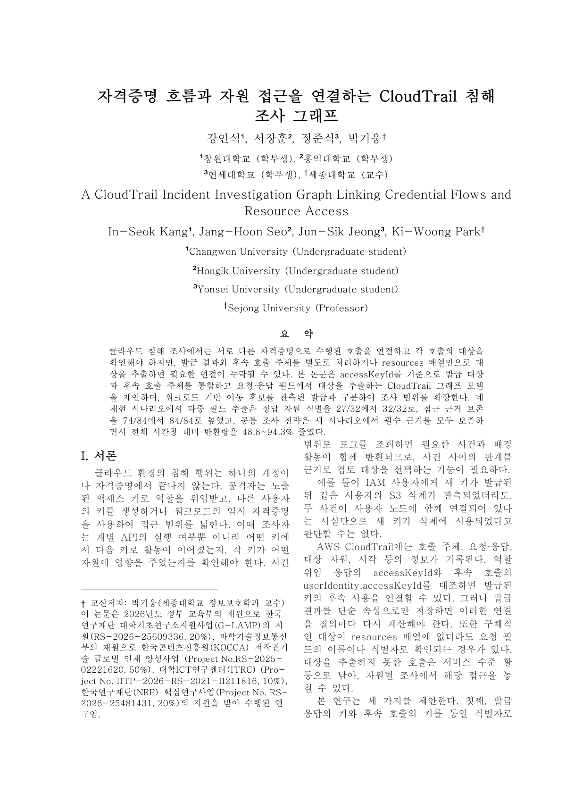

## 슬라이드 보기

슬라이드 1

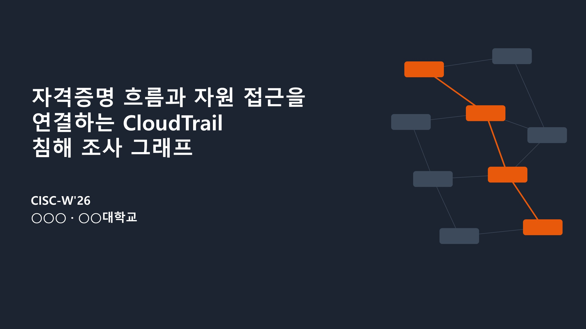

슬라이드 2

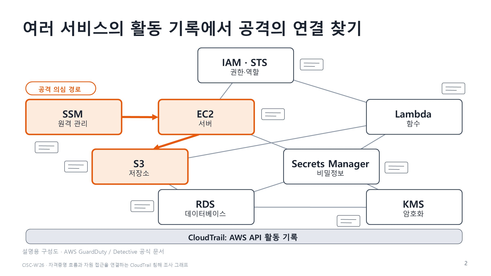

슬라이드 3

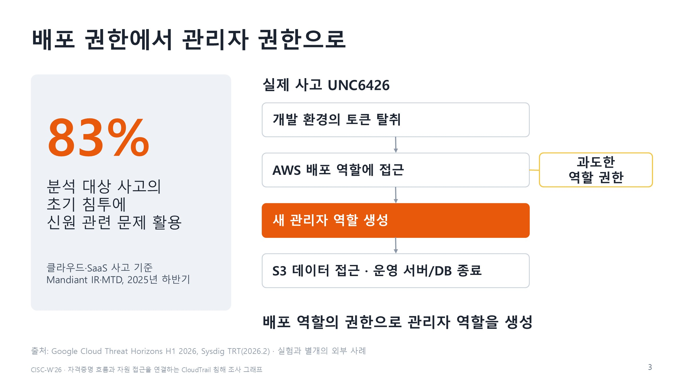

슬라이드 4

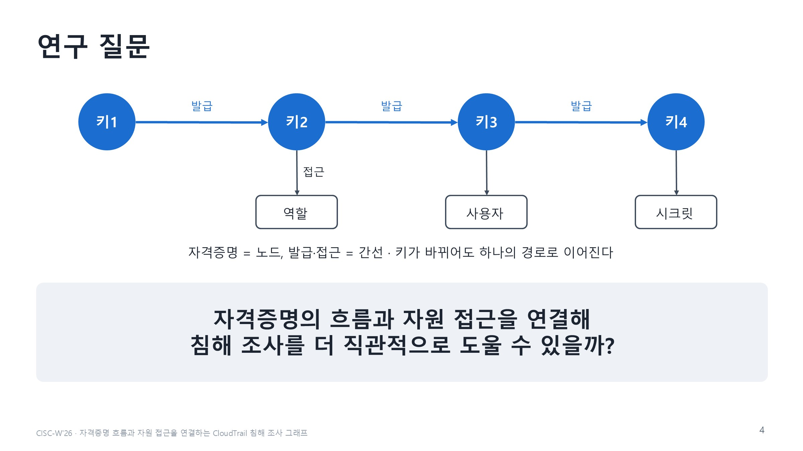

슬라이드 5

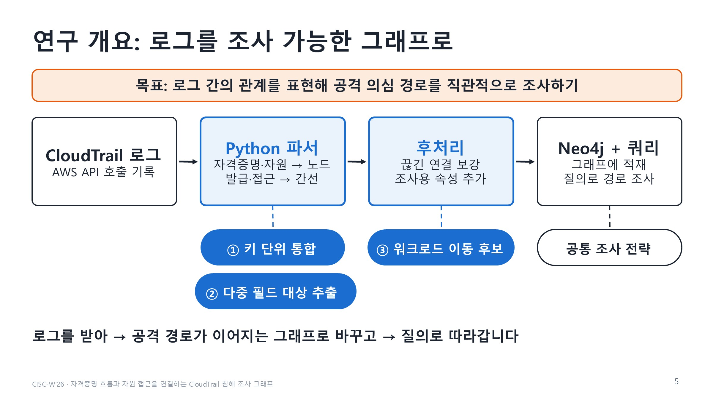

슬라이드 6

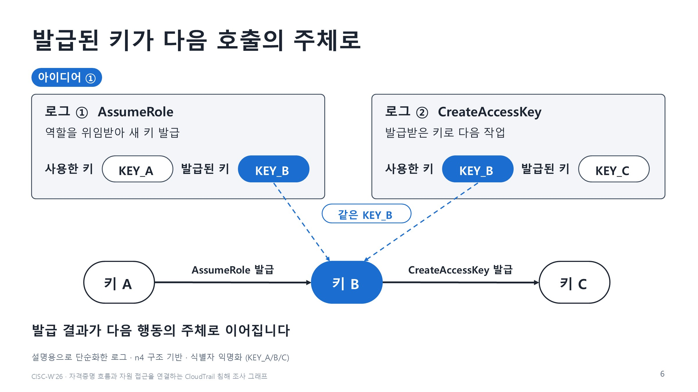

슬라이드 7

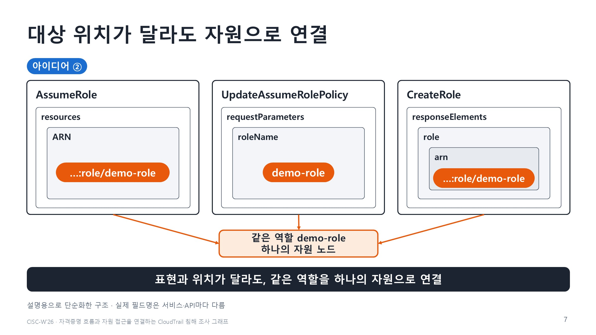

슬라이드 8

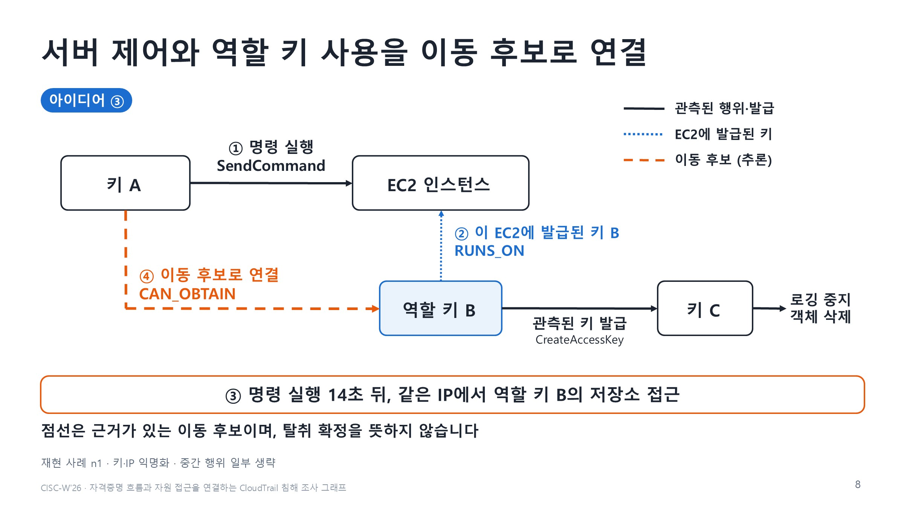

슬라이드 9

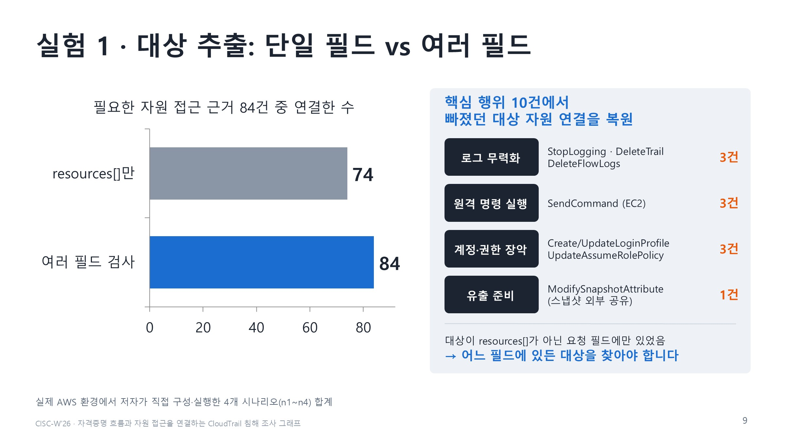

슬라이드 10

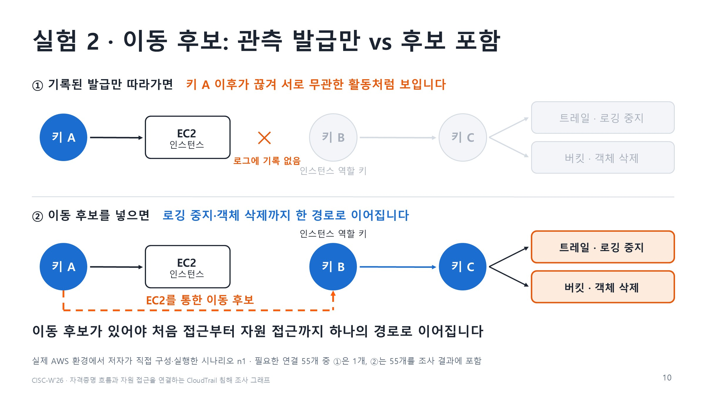

슬라이드 11

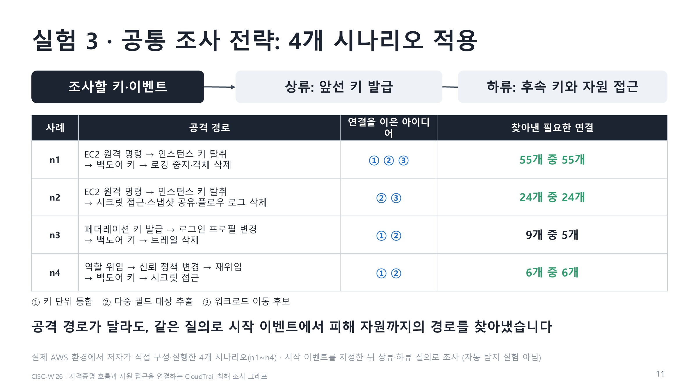

슬라이드 12

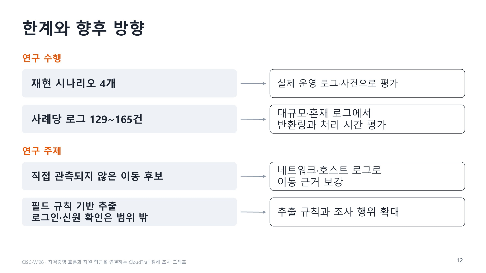

슬라이드 13

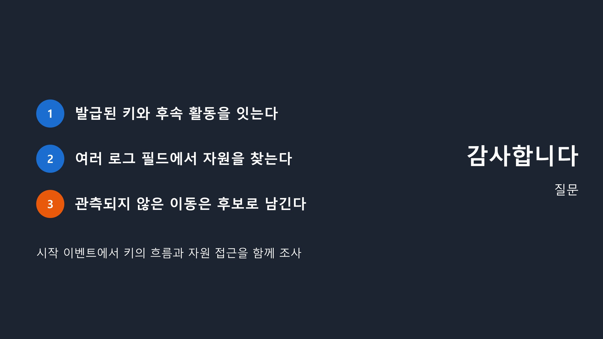

## 자료 안내

- 논문과 발표 파일은 제공된 원본을 내용 변경 없이 보관했습니다.
- 논문은 제안 구조·실험 범위를, 연결된 구현 저장소는 후속 개발 자료를 포함할 수 있습니다.
