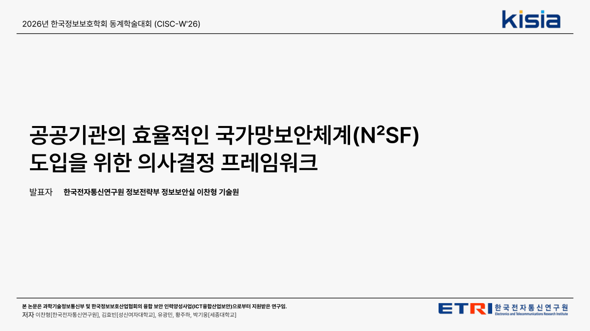

# 공공기관의 효율적인 국가망보안체계(N²SF) 도입을 위한 의사결정 프레임워크

**2026년 한국정보보호학회 동계학술대회 CISC-W’26 · 구두발표**

이찬형 · 김효빈 · 유광민 · 황주하 · 박기웅

> **행정안전부 장관상** · CISC-W’26 · 2026.10.29

기존 보안통제의 구현·운영 상태를 검증하고, 보완 대안을 예산과 인력 여건에 따라 비교·선택하는 절차를 제안했습니다.

[논문 원문](paper.pdf) · [발표 자료](presentation.pdf) · [전체 연구 목록](../../README.md)

## 자료 안내

- 논문과 발표 파일은 제공된 원본을 내용 변경 없이 보관했습니다.
- 논문은 제안 구조·실험 범위를, 연결된 구현 저장소는 후속 개발 자료를 포함할 수 있습니다.
