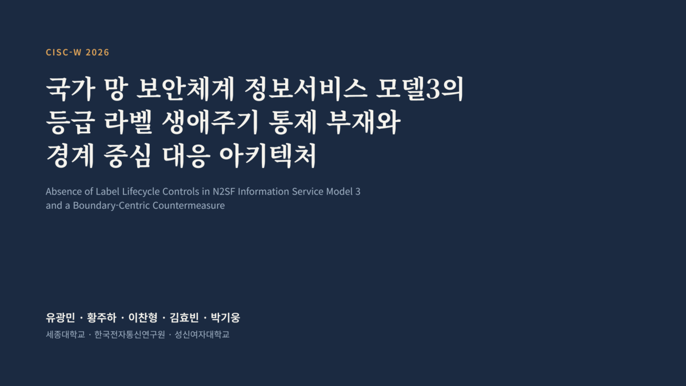

# 국가 망 보안체계 정보서비스 모델3의 등급 라벨 생애주기 통제 부재와 경계 중심 대응 아키텍처

**2026년 한국정보보호학회 동계학술대회 CISC-W’26 · 구두발표**

유광민 · 황주하 · 이찬형 · 김효빈 · 박기웅

> **한국정보보호학회장상** · CISC-W’26 · 2026.10.29

정보의 이동·변경 과정에서 발생하는 등급 라벨의 공백을 분석하고, 경계 통제점과 등급 원장을 활용하는 대응 구조를 제안했습니다.

[논문 원문](paper.pdf) · [발표 자료](presentation.pdf) · [전체 연구 목록](../../README.md)

## 자료 안내

- 논문과 발표 파일은 제공된 원본을 내용 변경 없이 보관했습니다.
- 논문은 제안 구조·실험 범위를, 연결된 구현 저장소는 후속 개발 자료를 포함할 수 있습니다.
