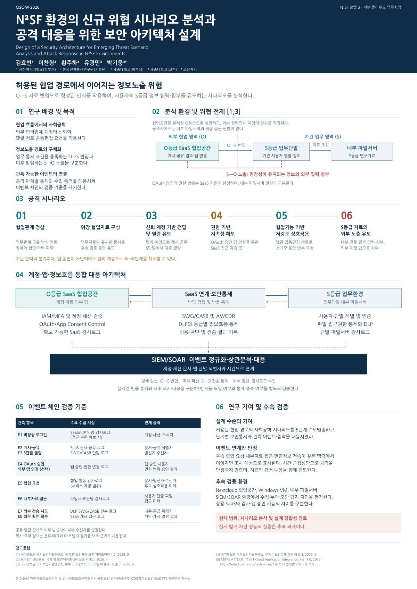

# N2SF 환경의 신규 위협 시나리오 분석과 공격 대응을 위한 보안 아키텍처 설계

**2026년 한국정보보호학회 동계학술대회 CISC-W’26 · 포스터**

김효빈 · 이찬형 · 황주하 · 유광민 · 박기웅

외부 SaaS 협업에서 중요정보가 노출되는 경로를 모델링하고, 단계별 통제 지점과 관측 기준을 제시했습니다.

[논문 원문](paper.pdf) · [발표 자료](presentation.pdf) · [전체 연구 목록](../../README.md)

## 자료 안내

- 논문과 발표 파일은 제공된 원본을 내용 변경 없이 보관했습니다.
- 논문은 제안 구조·실험 범위를, 연결된 구현 저장소는 후속 개발 자료를 포함할 수 있습니다.
