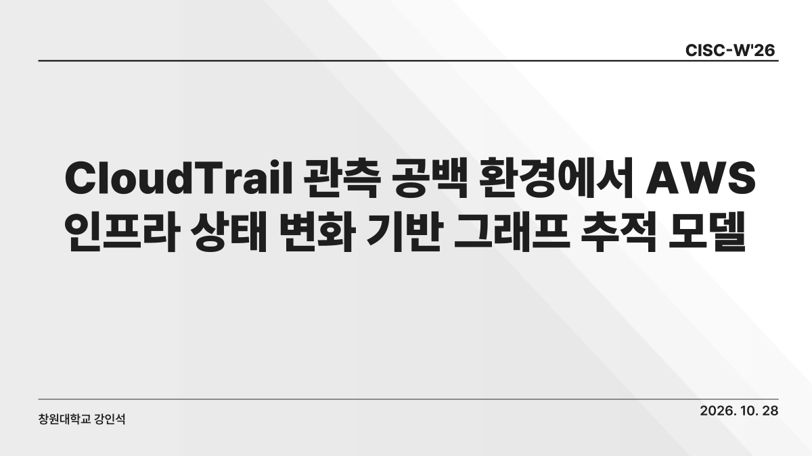

# CloudTrail 관측 공백 환경에서 AWS 인프라 상태 변화 기반 그래프 추적 모델

**2026년 한국정보보호학회 동계학술대회 CISC-W’26 · 구두발표**

강인석 · 서장훈 · 정준식 · 박기웅

CloudTrail 기록이 없는 구간에서 사고 전후의 인프라 상태 차이를 비교하고, 변경 흔적의 연관 관계를 그래프로 구성했습니다.

[논문 원문](paper.pdf) · [발표 자료](presentation.pdf) · [구현 저장소](https://github.com/ICT-Zero-Cloud/Trace_Erase) · [전체 연구 목록](../../README.md)

## 자료 안내

- 논문과 발표 파일은 제공된 원본을 내용 변경 없이 보관했습니다.
- 논문은 제안 구조·실험 범위를, 연결된 구현 저장소는 후속 개발 자료를 포함할 수 있습니다.
