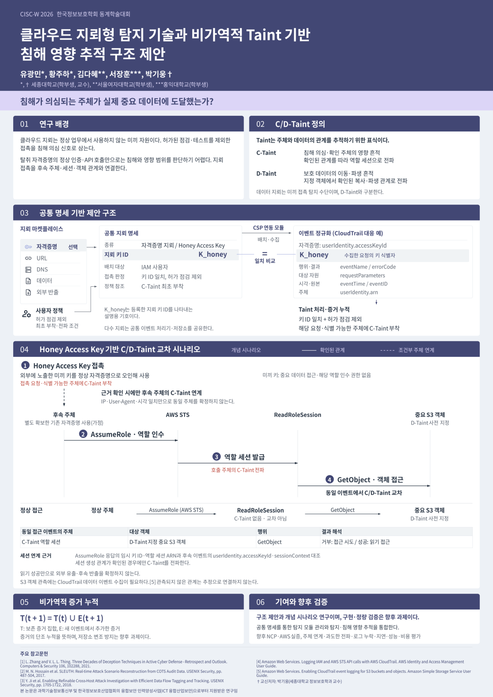

# 클라우드 지뢰형 탐지 기술과 비가역적 Taint 기반 침해 영향 추적 구조 제안

**2026년 한국정보보호학회 동계학술대회 CISC-W’26 · 포스터**

유광민 · 황주하 · 김다혜 · 서장훈 · 박기웅

클라우드 지뢰의 접촉 신호와 중요정보의 이동 흔적을 구분해 추적하고, 두 표식이 교차하는 접근 관계를 식별하는 구조를 제안했습니다.

[논문 원문](paper.pdf) · [발표 자료](presentation.pdf) · [구현 저장소](https://github.com/ICT-Zero-Cloud/taint-analysis) · [전체 연구 목록](../../README.md)

## 자료 안내

- 논문과 발표 파일은 제공된 원본을 내용 변경 없이 보관했습니다.
- 논문은 제안 구조·실험 범위를, 연결된 구현 저장소는 후속 개발 자료를 포함할 수 있습니다.
