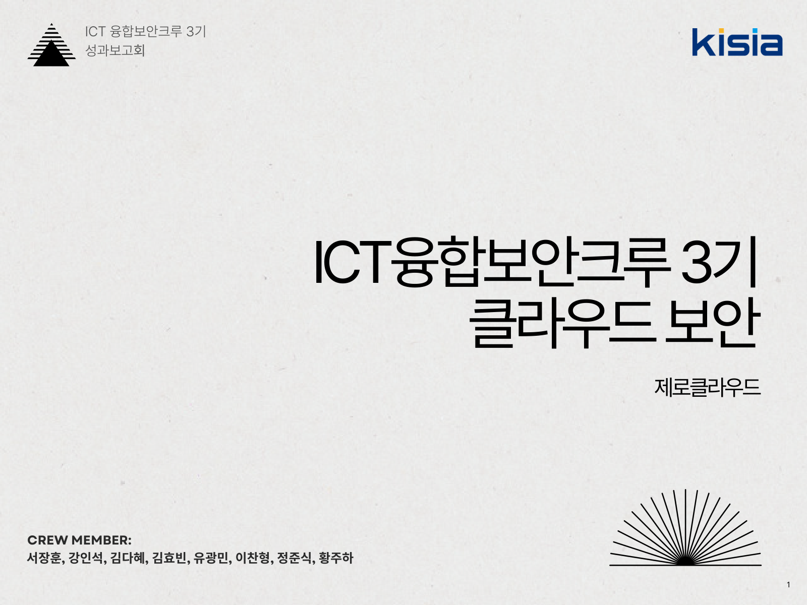
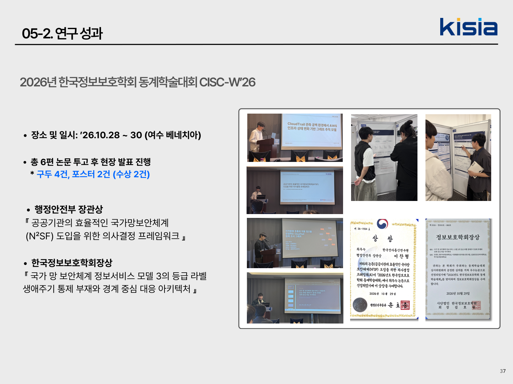
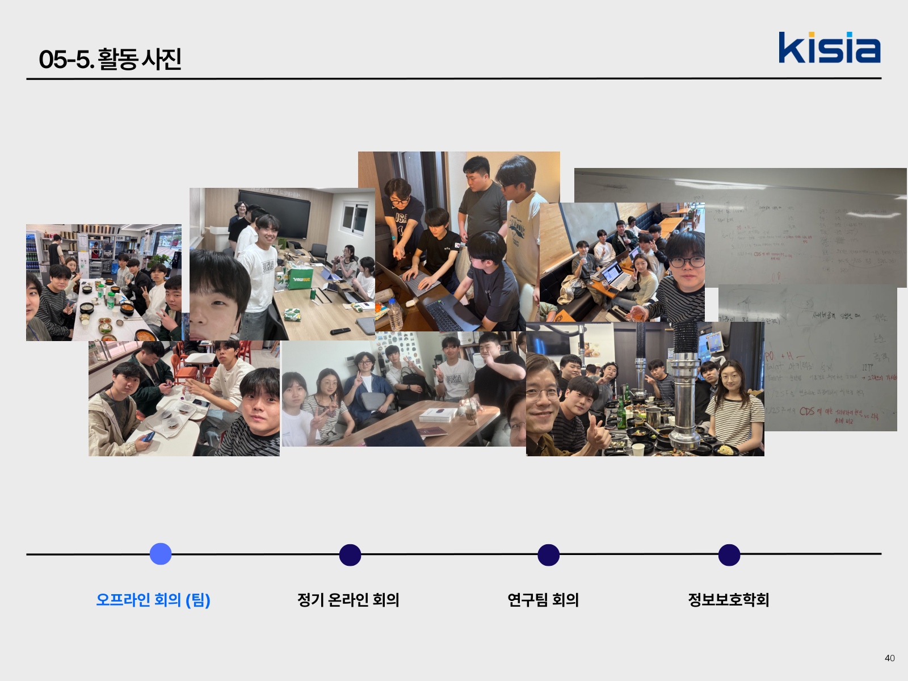

# ICT 융합보안크루 3기 성과보고회

## ICT 융합보안 우수크루상

**제로클라우드 · 한국정보보호산업협회(KISIA) · 2026년 11월 10일**

N2SF, Taint, 그래프 시각화를 주제로 수행한 클라우드 보안 연구와 활동 결과를 정리했습니다.

[최종 발표 자료 · PDF](final-presentation.pdf) · [논문·학회 발표 목록](../README.md) · [KISIA ICT융합보안크루 아카이브](https://kisiadev.github.io/ict-archive/)

## 학술 성과

2026년 한국정보보호학회 동계학술대회 CISC-W’26에 논문 6편을 투고하고, 구두발표 4건과 포스터 발표 2건을 진행했습니다. 이 가운데 2편이 수상했습니다.

| 수상 | 논문 |
| --- | --- |
| 행정안전부 장관상 | [공공기관의 효율적인 국가망보안체계(N²SF) 도입을 위한 의사결정 프레임워크](../research/n2sf-adoption/) |
| 한국정보보호학회장상 | [국가 망 보안체계 정보서비스 모델3의 등급 라벨 생애주기 통제 부재와 경계 중심 대응 아키텍처](../research/n2sf-label/) |

## 활동 기록

서장훈 · 강인석 · 김다혜 · 김효빈 · 유광민 · 이찬형 · 정준식 · 황주하

## 공개본 안내

발표 자료는 부록을 포함한 공개본입니다. 개인 식별 정보가 포함된 교육·자격증 증빙 1쪽은 제외했습니다. 학회 수상 기록과 연구·활동 내용은 유지했습니다.
