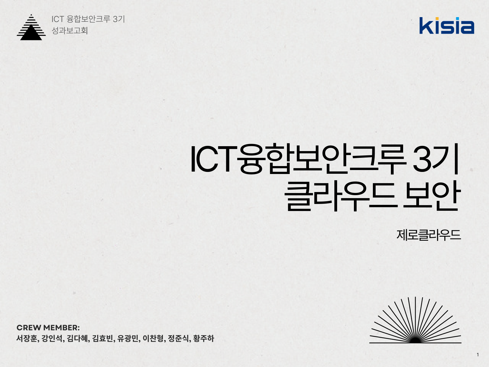

KISIA · ICT CONVERGENCE SECURITY CREW · 3RD

# 제로클라우드

### 클라우드 보안 연구 아카이브

중요정보의 흐름을 통제하고, 침해의 영향을 추적하고, 사고의 경로를 재구성합니다.

**논문·학술발표 6편** &nbsp; · &nbsp; **학회 수상 2건** &nbsp; · &nbsp; **ICT 융합보안 우수크루상**

[논문·발표 자료](#논문과-학회-발표) &nbsp; / &nbsp; [수상 성과](#수상-성과) &nbsp; / &nbsp; [성과보고회](#성과보고회와-활동-기록) &nbsp; / &nbsp; [KISIA 아카이브](https://kisiadev.github.io/ict-archive/)

---

## 수상 성과

<table>
<tr>
<td width="33%" valign="top">
2026.11.10 · KISIA
<h3>ICT 융합보안 우수크루상</h3>

<b>제로클라우드</b> ICT 융합보안크루 3기

<a href="https://github.com/ICT-Zero-Cloud/.github/blob/ae8c0e1eac207a3c0ad91f83c640fc0c02835f94/archive/showcase/README.md">성과보고회 기록 →</a>
</td>
<td width="33%" valign="top">
2026.10.29 · CISC-W’26
<h3>행정안전부 장관상</h3>

N²SF 도입을 위한 <b>의사결정 프레임워크</b>

<a href="https://github.com/ICT-Zero-Cloud/.github/blob/ae8c0e1eac207a3c0ad91f83c640fc0c02835f94/archive/research/n2sf-adoption/README.md">수상 논문 →</a>
</td>
<td width="33%" valign="top">
2026.10.29 · CISC-W’26
<h3>한국정보보호 학회장상</h3>

모델3의 등급 라벨 <b>생애주기 통제 연구</b>

<a href="https://github.com/ICT-Zero-Cloud/.github/blob/ae8c0e1eac207a3c0ad91f83c640fc0c02835f94/archive/research/n2sf-label/README.md">수상 논문 →</a>
</td>
</tr>
</table>

## 연구의 세 축

| N2SF · 사전 통제 | Taint · 침해 영향 추적 | 시각화 · 사고 조사 |
| :--- | :--- | :--- |
| 중요정보의 이동을 어떻게 통제할까? | 침해 의심 주체가 어떤 중요정보에 접근했을까? | 흩어진 기록과 남은 흔적으로 사고 흐름을 어떻게 재구성할까? |
| 위협·통제 지점, 등급 라벨, 도입 의사결정 | 클라우드 지뢰, 주체·데이터 표식, 교차 지점 | 자격증명·자원 접근 연결, 인프라 상태 변화 |
| **논문 3편** | **논문 1편** | **논문 2편** |

## 논문과 학회 발표

**2026년 한국정보보호학회 동계학술대회 CISC-W’26** 
2026.10.28–30 · 여수 베네치아 · 구두발표 4건 / 포스터 발표 2건

### 01 · N2SF — 중요정보의 흐름 통제

**「N2SF 환경의 신규 위협 시나리오 분석과 공격 대응을 위한 보안 아키텍처 설계」** 
외부 SaaS 협업에서 중요정보가 노출되는 경로를 모델링하고, 단계별 통제 지점과 관측 기준을 제시했습니다. 
CISC-W’26 · 포스터 
[논문 원문](https://github.com/ICT-Zero-Cloud/.github/blob/ae8c0e1eac207a3c0ad91f83c640fc0c02835f94/archive/research/n2sf-threat/paper.pdf) · [발표 자료](https://github.com/ICT-Zero-Cloud/.github/blob/ae8c0e1eac207a3c0ad91f83c640fc0c02835f94/archive/research/n2sf-threat/presentation.pdf) · [연구 소개](https://github.com/ICT-Zero-Cloud/.github/blob/ae8c0e1eac207a3c0ad91f83c640fc0c02835f94/archive/research/n2sf-threat/README.md)

**「국가 망 보안체계 정보서비스 모델3의 등급 라벨 생애주기 통제 부재와 경계 중심 대응 아키텍처」** 
정보의 이동·변경 과정에서 발생하는 등급 라벨의 공백을 분석하고, 경계 통제점과 등급 원장을 활용하는 대응 구조를 제안했습니다. 
CISC-W’26 · 구두발표 · **한국정보보호학회장상** 
[논문 원문](https://github.com/ICT-Zero-Cloud/.github/blob/ae8c0e1eac207a3c0ad91f83c640fc0c02835f94/archive/research/n2sf-label/paper.pdf) · [발표 자료](https://github.com/ICT-Zero-Cloud/.github/blob/ae8c0e1eac207a3c0ad91f83c640fc0c02835f94/archive/research/n2sf-label/presentation.pdf) · [연구 소개](https://github.com/ICT-Zero-Cloud/.github/blob/ae8c0e1eac207a3c0ad91f83c640fc0c02835f94/archive/research/n2sf-label/README.md)

**「공공기관의 효율적인 국가망보안체계(N²SF) 도입을 위한 의사결정 프레임워크」** 
기존 보안통제의 구현·운영 상태를 검증하고, 보완 대안을 예산과 인력 여건에 따라 비교·선택하는 절차를 제안했습니다. 
CISC-W’26 · 구두발표 · **행정안전부 장관상** 
[논문 원문](https://github.com/ICT-Zero-Cloud/.github/blob/ae8c0e1eac207a3c0ad91f83c640fc0c02835f94/archive/research/n2sf-adoption/paper.pdf) · [발표 자료](https://github.com/ICT-Zero-Cloud/.github/blob/ae8c0e1eac207a3c0ad91f83c640fc0c02835f94/archive/research/n2sf-adoption/presentation.pdf) · [연구 소개](https://github.com/ICT-Zero-Cloud/.github/blob/ae8c0e1eac207a3c0ad91f83c640fc0c02835f94/archive/research/n2sf-adoption/README.md)

### 02 · Taint — 침해 영향 추적

**「클라우드 지뢰형 탐지 기술과 비가역적 Taint 기반 침해 영향 추적 구조 제안」** 
클라우드 지뢰의 접촉 신호와 중요정보의 이동 흔적을 구분해 추적하고, 두 표식이 교차하는 접근 관계를 식별하는 구조를 제안했습니다. 
CISC-W’26 · 포스터 
[논문 원문](https://github.com/ICT-Zero-Cloud/.github/blob/ae8c0e1eac207a3c0ad91f83c640fc0c02835f94/archive/research/taint/paper.pdf) · [발표 자료](https://github.com/ICT-Zero-Cloud/.github/blob/ae8c0e1eac207a3c0ad91f83c640fc0c02835f94/archive/research/taint/presentation.pdf) · [연구 소개](https://github.com/ICT-Zero-Cloud/.github/blob/ae8c0e1eac207a3c0ad91f83c640fc0c02835f94/archive/research/taint/README.md) · [구현 자료](https://github.com/ICT-Zero-Cloud/taint-analysis)

### 03 · 시각화 — 사고 경로 재구성

**「자격증명 흐름과 자원 접근을 연결하는 CloudTrail 침해 조사 그래프」** 
발급된 자격증명과 후속 호출, 자원 접근을 연결해 CloudTrail의 흩어진 기록을 조사 경로로 재구성했습니다. 
CISC-W’26 · 구두발표 
[논문 원문](https://github.com/ICT-Zero-Cloud/.github/blob/ae8c0e1eac207a3c0ad91f83c640fc0c02835f94/archive/research/credential-graph/paper.pdf) · [발표 자료](https://github.com/ICT-Zero-Cloud/.github/blob/ae8c0e1eac207a3c0ad91f83c640fc0c02835f94/archive/research/credential-graph/presentation.pptx) · [연구 소개](https://github.com/ICT-Zero-Cloud/.github/blob/ae8c0e1eac207a3c0ad91f83c640fc0c02835f94/archive/research/credential-graph/README.md) · [구현 자료](https://github.com/ICT-Zero-Cloud/cloud-attack-path-visualization)

**「CloudTrail 관측 공백 환경에서 AWS 인프라 상태 변화 기반 그래프 추적 모델」** 
CloudTrail 기록이 없는 구간에서 사고 전후의 인프라 상태 차이를 비교하고, 변경 흔적의 연관 관계를 그래프로 구성했습니다. 
CISC-W’26 · 구두발표 
[논문 원문](https://github.com/ICT-Zero-Cloud/.github/blob/ae8c0e1eac207a3c0ad91f83c640fc0c02835f94/archive/research/state-change-graph/paper.pdf) · [발표 자료](https://github.com/ICT-Zero-Cloud/.github/blob/ae8c0e1eac207a3c0ad91f83c640fc0c02835f94/archive/research/state-change-graph/presentation.pdf) · [연구 소개](https://github.com/ICT-Zero-Cloud/.github/blob/ae8c0e1eac207a3c0ad91f83c640fc0c02835f94/archive/research/state-change-graph/README.md) · [구현 자료](https://github.com/ICT-Zero-Cloud/Trace_Erase)

## 성과보고회와 활동 기록

[최종 발표 자료 · PDF](https://github.com/ICT-Zero-Cloud/.github/blob/ae8c0e1eac207a3c0ad91f83c640fc0c02835f94/archive/showcase/final-presentation.pdf) &nbsp; · &nbsp; [학회 수상·활동 기록](https://github.com/ICT-Zero-Cloud/.github/blob/ae8c0e1eac207a3c0ad91f83c640fc0c02835f94/archive/showcase/README.md)

## 구현 자료

| 저장소 | 연구 내용 |
| --- | --- |
| [taint-analysis](https://github.com/ICT-Zero-Cloud/taint-analysis) | 클라우드 지뢰와 C/D-Taint 기반 침해 영향 추적 |
| [cloud-attack-path-visualization](https://github.com/ICT-Zero-Cloud/cloud-attack-path-visualization) | CloudTrail 자격증명 흐름과 자원 접근의 그래프 재구성 |
| [Trace_Erase](https://github.com/ICT-Zero-Cloud/Trace_Erase) | AWS 인프라 스냅샷 수집, 상태 변화 분석과 시각화 |

## 함께한 사람들

서장훈 · 강인석 · 김다혜 · 김효빈 · 유광민 · 이찬형 · 정준식 · 황주하 
연구 지도 · 박기웅 교수

---

**KISIA ICT 융합보안크루 3기 · 제로클라우드** 
[ICT융합보안크루 아카이브](https://kisiadev.github.io/ict-archive/) · [전체 자료 목록](https://github.com/ICT-Zero-Cloud/.github/tree/ae8c0e1eac207a3c0ad91f83c640fc0c02835f94/archive)

